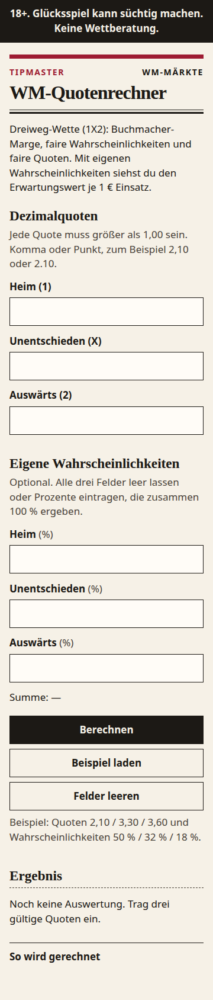
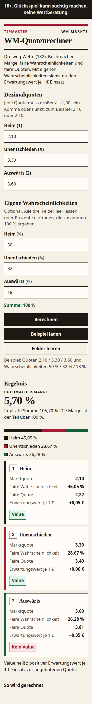
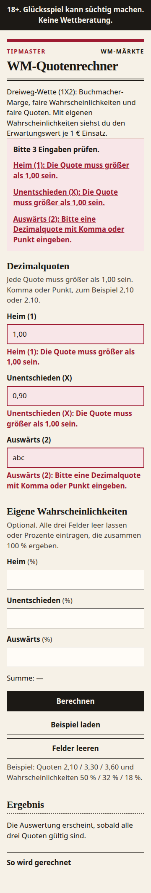
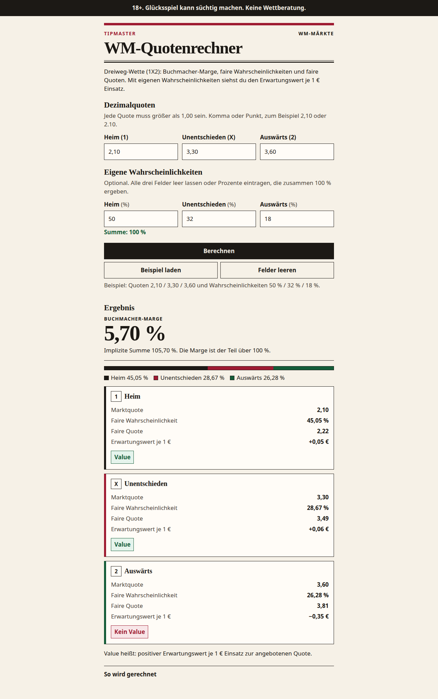

# WM-Quotenrechner

Eigenständige Seite für Dreiweg-Quoten (Heim, Unentschieden, Auswärts). Sie zeigt die Buchmacher-Marge, faire Wahrscheinlichkeiten und faire Quoten nach der proportionalen Methode. Mit optionalen eigenen Wahrscheinlichkeiten kommt der Erwartungswert je 1 € dazu — und die Einschätzung Value oder Kein Value.

Keine Bau-Schritte, keine externen Requests. Alles steht in `index.html`.

## Öffnen

Die Datei `index.html` direkt im Browser öffnen.

Oder lokal ausliefern:

```bash
python3 -m http.server 8741
```

Dann http://127.0.0.1:8741 aufrufen.

In der Browser-Konsole laufen drei Selbsttests der Rechenfunktionen.

## Ansicht

Leerer Rechner bei 360px:



Auswertung mit Marge, fairen Quoten, Value und Kein Value:



Deutsche Fehlermeldungen, wenn eine Quote nicht größer als 1,00 ist oder keine Dezimalzahl ist:



Dieselbe Auswertung auf breitem Fenster:



## Ablauf

Kurzes Video, etwa 40 Sekunden: Beispiel laden, Buchmacher-Marge 5,70 % mit Value und Kein Value, danach die deutsche Fehlermeldung bei ungültigen Quoten.

[Demo ansehen](docs/demo/quotenrechner-beispiel-value-und-fehler.mp4)

## Rechnung

- Implizite Wahrscheinlichkeit = 1 / Dezimalquote
- Buchmacher-Marge = (Summe der impliziten Wahrscheinlichkeiten − 1) × 100
- Faire Wahrscheinlichkeit = implizite Wahrscheinlichkeit / Summe (proportionale Methode)
- Faire Quote = 1 / faire Wahrscheinlichkeit
- Erwartungswert je 1 € = eigene Wahrscheinlichkeit × angebotene Quote − 1

18+. Glücksspiel kann süchtig machen. Keine Wettberatung.
